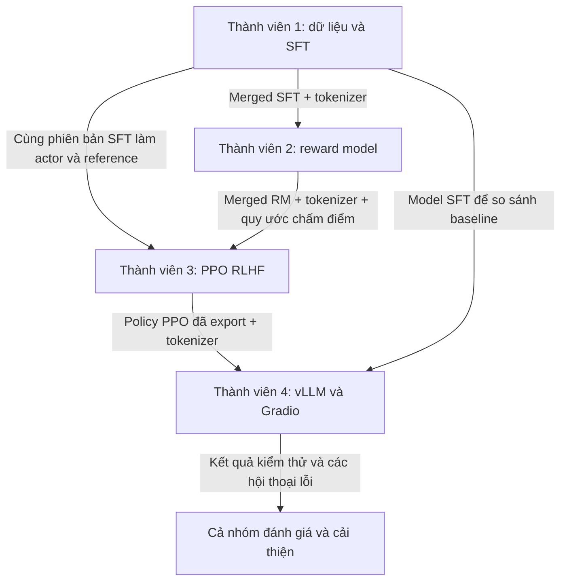

# Vietnamese Chatbot using LLM & RLHF

Dự án nhóm xây dựng chatbot tiếng Việt dựa trên **Llama-3.2-1B-Instruct**, kết hợp Supervised Fine-Tuning (SFT), mô hình điểm thưởng (Reward Model) và căn chỉnh bằng PPO RLHF. Chatbot hướng tới phản hồi tự nhiên, lịch sự và giữ ngữ cảnh hội thoại nhiều lượt.

**Trạng thái hiện tại:** repository mới có cấu trúc dự án, tài liệu phân công và các file mã nguồn TODO. Chưa có pipeline huấn luyện hoặc giao diện chạy hoàn chỉnh; chưa có kết quả đánh giá chất lượng. Các bước cài đặt dưới đây chuẩn bị môi trường, không đồng nghĩa script đã hoạt động.

## Mục tiêu và pipeline

1. Chuẩn bị dữ liệu hội thoại tiếng Việt và áp dụng chat template.
2. Tinh chỉnh model nền bằng QLoRA để tạo model SFT.
3. Huấn luyện reward model trên các cặp phản hồi được chọn/bị từ chối.
4. Dùng reward model để căn chỉnh policy SFT bằng PPO, theo dõi KL với model tham chiếu.
5. Phục vụ policy cuối bằng vLLM và xây giao diện hội thoại Gradio.

**Luồng chính:** dữ liệu → SFT → reward model → PPO → vLLM API → Gradio.

| Thành phần | Công nghệ dự kiến |
|---|---|
| Model nền | Llama-3.2-1B-Instruct |
| SFT / QLoRA | Unsloth, Transformers, TRL, PEFT |
| Reward model | OpenRLHF, DeepSpeed, LoRA |
| PPO RLHF | OpenRLHF, Ray, vLLM |
| Serving / UI | vLLM, Gradio, client Python `openai` |
| Model / theo dõi | Hugging Face Hub, WandB |

## Cấu trúc thư mục

Các đường dẫn dưới đây tính từ thư mục dự án `aio-chatbot-llm-rlhf/` trong repository:

```text
aio-chatbot-llm-rlhf/
├── data/
│   ├── raw/             # Dữ liệu gốc, không commit dataset
│   └── processed/       # Dữ liệu sau xử lý
├── docs/                # Hướng dẫn thành viên và Git
├── src/
│   ├── sft/             # Xử lý dữ liệu và huấn luyện SFT
│   ├── reward_model/    # Huấn luyện RM và merge adapter
│   ├── rlhf/            # PPO và cấu hình Ray
│   └── deployment/      # vLLM và giao diện Gradio
├── assets/              # Ảnh, sơ đồ, biểu đồ
├── .gitignore
├── requirements.txt
├── README.md
└── LICENSE
```

## Dữ liệu

| Giai đoạn | Dataset tham khảo từ tài liệu dự án |
|---|---|
| SFT | `5CD-AI/Vietnamese-Multi-turn-Chat-Alpaca` |
| Reward model | `thuanan/Vi-Alpaca-Preference` |
| PPO prompts | `thuanan/Prompt-Vi-Alpaca-Preference-2k` |

Kiểm tra schema, revision và điều kiện sử dụng trước khi tải. Tách dữ liệu đánh giá khỏi dữ liệu huấn luyện; lưu dữ liệu lớn ngoài Git. Ghi dataset/model revision để nhóm có thể tái tạo thí nghiệm.

## Yêu cầu môi trường

- Git và Python; chọn phiên bản Python nằm trong vùng hỗ trợ chung của các package trong từng môi trường. Python 3.12 là điểm tham khảo cho serving trong tài liệu gốc, chưa phải cấu hình đã kiểm thử của repo.
- Pipeline GPU theo tài liệu dự án hướng tới Linux và GPU NVIDIA có driver phù hợp. SFT có thể chuẩn bị trên Google Colab GPU.
- RM/PPO cần cấu hình tài nguyên theo số vai trò và bộ nhớ thực tế; không mặc định toàn bộ PPO chạy được trên Colab một GPU.
- macOS có thể dùng để phát triển, viết docs và chạy UI kết nối server GPU. Hướng dẫn này không thiết lập pipeline huấn luyện CUDA trên macOS.
- Hugging Face token khi model/dataset cần quyền truy cập; WandB key nếu dùng theo dõi thí nghiệm.

## Setup môi trường

### 1. Lấy mã nguồn

Nếu chưa có repo trên máy, chạy tại nơi muốn lưu dự án:

```bash
git clone https://github.com/PhiDucTung/Vietnamese-Chatbot-LLM.git
cd Vietnamese-Chatbot-LLM/aio-chatbot-llm-rlhf
```

Nếu đã clone, mở terminal tại `aio-chatbot-llm-rlhf/`. Từ bước này, mọi đường dẫn shell được tính từ thư mục dự án đó.

### 2. Tạo môi trường ảo

Dùng môi trường riêng cho SFT, RM/PPO và serving. Ví dụ dưới tạo môi trường ngoài repository để tránh commit nhầm; chạy bằng Bash/Zsh trên Linux hoặc macOS:

```bash
python3 -m venv "$HOME/.venvs/vietnamese-chatbot-sft"
source "$HOME/.venvs/vietnamese-chatbot-sft/bin/activate"
python -m pip install --upgrade pip
```

Khi đổi giai đoạn, chạy `deactivate`, tạo môi trường khác theo cùng cách, thay hậu tố `sft` bằng `rm-ppo` hoặc `serve`. Trong Colab, dùng runtime riêng cho mỗi giai đoạn thay vì mặc định môi trường ảo local; restart runtime sau khi đổi dependency khi cần.

### 3. Chọn và cài dependency theo giai đoạn

**`requirements.txt` hiện chỉ là danh sách được chú thích. Chạy cài từ file này lúc này sẽ không cài stack huấn luyện.** Chỉ bỏ chú thích và khóa các phiên bản sau khi nhóm thống nhất bộ package tương thích.

| Môi trường | Cách chuẩn bị |
|---|---|
| SFT | Cài Unsloth theo hướng dẫn GPU/notebook chính thức; kiểm tra các phiên bản PyTorch, Transformers, TRL, PEFT và datasets đi kèm |
| RM/PPO | Chọn tag/commit OpenRLHF và hướng dẫn container/dependency tương ứng; kiểm tra Ray, DeepSpeed, vLLM và GPU trước khi huấn luyện |
| Serving | Cài vLLM theo hướng dẫn CUDA/GPU tương ứng; thêm Gradio và client `openai` vào môi trường đã chọn |
| UI riêng | Có thể chỉ cài Gradio và `openai`, kết nối tới vLLM chạy trên máy GPU khác |

Nguồn cài đặt: [Unsloth](https://github.com/unslothai/unsloth), [OpenRLHF](https://github.com/OpenRLHF/OpenRLHF), [vLLM GPU](https://docs.vllm.ai/en/stable/getting_started/installation/gpu/), [Gradio](https://github.com/gradio-app/gradio).

Ví dụ cài các package cho **UI riêng** trong môi trường mới (chưa cài server GPU):

```bash
python -m pip install gradio openai
python -m pip check
```

Lệnh trên lấy phiên bản mà trình cài đặt giải quyết tại thời điểm chạy; sau khi kiểm tra thành công, ghi lại phiên bản để cả nhóm dùng thống nhất. Chưa có lockfile được kiểm chứng trong repo.

Tài liệu dự án gốc sử dụng Unsloth `2025.4.7`, datasets `3.5.1`. Đây là mốc tham khảo để tái lập, không bảo đảm tương thích với các package mới nhất. Không trộn cờ CLI của OpenRLHF cũ với bản hiện tại.

### 4. Kiểm tra môi trường

Trên máy Linux/Colab NVIDIA:

```bash
nvidia-smi
```

Sau khi đã cài PyTorch trong môi trường huấn luyện, kiểm tra:

```bash
python -c 'import torch; print("PyTorch:", torch.__version__); print("CUDA:", torch.cuda.is_available()); print("CUDA build:", torch.version.cuda)'
python -m pip check
```

Chỉ bật BF16 khi GPU hỗ trợ. Ghi lại GPU/VRAM, Python, CUDA, package versions và container/commit OpenRLHF trước mỗi run. Có thể xem danh sách package bằng `python -m pip freeze`; kiểm tra dependency thành công chưa thay thế được smoke test huấn luyện.

### 5. Cấu hình truy cập và kết nối

Nạp secret bằng trình quản lý thông tin xác thực, Colab Secrets hoặc biến môi trường; không ghi giá trị thật vào code/notebook.

| Biến môi trường | Ý nghĩa |
|---|---|
| `HF_TOKEN` | Truy cập Hugging Face, quyền ghi chỉ khi cần upload |
| `WANDB_API_KEY` | Theo dõi thí nghiệm nếu bật WandB |
| `SFT_MODEL` | Đường dẫn hoặc repo model SFT đã merge |
| `RM_MODEL` | Đường dẫn hoặc repo reward model có reward head |
| `PPO_MODEL` | Đường dẫn hoặc repo policy PPO dùng inference |
| `OPENAI_API_KEY` | Khóa truy cập vLLM của nhóm |
| `OPENAI_API_BASE_URL` | URL API, ví dụ `http://127.0.0.1:8000/v1` |
| `CHAT_MODEL` | Model ID được server vLLM phục vụ |

Đây là quy ước để triển khai script, chưa được các file TODO tự động đọc. Khóa vLLM độc lập với token Hugging Face. Nếu UI và server khác máy, thay loopback bằng địa chỉ kết nối thực tế.

## Phân công và mối liên hệ giữa 4 thành viên

Các giai đoạn nối tiếp nhau qua **model, tokenizer, cấu hình và kết quả kiểm tra**. Mỗi người vừa phát triển module của mình, vừa xác nhận đầu vào nhận từ người trước có thể sử dụng được.



### Thành viên 1 — Dữ liệu và model SFT

**Phụ trách:** `src/sft/`. Chuẩn bị dữ liệu hội thoại, chuẩn hóa vai trò, áp dụng chat template, tách tập đánh giá và huấn luyện QLoRA trên model nền.

**Bàn giao cho thành viên 2:** model SFT đã merge vào model nền, tokenizer/chat template và thông tin model nền chính xác. Thành viên 2 dùng model này làm điểm khởi tạo cho reward model, bổ sung đầu chấm điểm và học từ dữ liệu chosen/rejected.

**Bàn giao cho thành viên 3:** cùng phiên bản model SFT và tokenizer. Thành viên 3 dùng SFT để khởi tạo actor và tạo reference cố định cho PPO. Hai bên cần thống nhất revision để việc tính KL có mốc tham chiếu rõ ràng.

**Bàn giao cho thành viên 4:** model SFT hoặc đường dẫn/revision để chạy baseline so sánh với PPO; kèm một số hội thoại mẫu để kiểm thử UI và chất lượng.

Artifact cần có: adapter LoRA lưu riêng, model merged đầy đủ, tokenizer, cấu hình huấn luyện, revision dữ liệu và kết quả đánh giá. Trước bàn giao phải nạp lại model trong tiến trình mới và thử sinh phản hồi tiếng Việt nhiều lượt.

### Thành viên 2 — Reward model

**Phụ trách:** `src/reward_model/`. Nhận SFT từ thành viên 1, chuẩn bị dữ liệu preference, huấn luyện reward model và hợp nhất adapter mà vẫn giữ đầu chấm điểm (reward head).

**Bàn giao cho thành viên 3:** reward model hoàn chỉnh, tokenizer, cách format hội thoại và cách lấy điểm thưởng. Khi actor sinh phản hồi, thành viên 3 dùng RM chấm prompt cùng phản hồi để có tín hiệu cập nhật PPO. RM không thay thế policy sinh văn bản.

Bàn giao kèm revision SFT nguồn, cấu hình RM, quy ước padding/giới hạn độ dài và kết quả xếp hạng chosen/rejected trên tập đánh giá. Hai bên kiểm tra cùng một vài cặp mẫu để bảo đảm loader PPO lấy điểm đúng như lúc đánh giá RM.

Nếu model chấm điểm sai nhiều hoặc head bị mất sau merge, thành viên 2 xử lý trước khi thành viên 3 chạy PPO đầy đủ. Nếu lỗi đến từ tokenizer hoặc SFT nguồn, phối hợp với thành viên 1 để sửa và thống nhất lại phiên bản.

### Thành viên 3 — PPO RLHF

**Phụ trách:** `src/rlhf/`. Nhận SFT từ thành viên 1 và RM từ thành viên 2; chuẩn bị prompts, tài nguyên GPU/Ray và chạy PPO. Actor học từ reward, reference giữ cố định để đo độ lệch KL, critic hỗ trợ ước lượng giá trị.

**Bàn giao cho thành viên 4:** policy sau PPO đã export ở dạng model sinh văn bản đầy đủ, tokenizer/chat template và cấu hình inference phù hợp. Checkpoint resume phục vụ tiếp tục huấn luyện phải lưu riêng; không mặc định checkpoint DeepSpeed hoặc adapter có thể nạp trực tiếp vào vLLM.

Bàn giao kèm model ID/revision, phiên bản SFT/RM đã dùng, cấu hình sinh, giới hạn ngữ cảnh, log reward/KL và kết quả so sánh SFT/PPO. Trước khi chuyển, kiểm tra policy nạp lại được và sinh phản hồi từ artifact export.

Nếu reward tăng nhưng phản hồi lặp, dài bất thường hoặc kém hữu ích, thành viên 3 xem lại PPO và phối hợp thành viên 2 kiểm tra RM; không chỉ chọn checkpoint có reward cao nhất. Nếu thay đổi SFT nền, cả nhóm xác định RM/PPO nào cần huấn luyện hoặc kiểm tra lại.

### Thành viên 4 — Serving và giao diện

**Phụ trách:** `src/deployment/`. Nhận policy PPO từ thành viên 3, khởi chạy vLLM API, kết nối Gradio và xử lý lịch sử hội thoại, streaming, giới hạn ngữ cảnh cùng lỗi kết nối.

**Phản hồi cho thành viên 3:** lỗi nạp policy, thiếu tokenizer/chat template, không tương thích định dạng export hoặc các hội thoại mà PPO trả lời chưa tốt. Thành viên 3 kiểm tra lại artifact hoặc cấu hình trước khi kết luận lỗi nằm ở UI.

**Phối hợp với thành viên 1:** dùng SFT làm baseline trên cùng bộ câu hỏi và điều kiện sinh. Nếu cả SFT lẫn PPO lỗi với một dạng câu hỏi, cả nhóm xem lại dữ liệu và bước SFT; nếu chỉ PPO suy giảm, ưu tiên kiểm tra RM/PPO.

**Bàn giao cho cả nhóm:** giao diện hoạt động, cấu hình model/API không chứa secret, cách khởi động hệ thống, ảnh minh họa, kết quả kiểm thử và danh sách hạn chế. Phân biệt lỗi phục vụ như timeout/context overflow với lỗi chất lượng nội dung.

### Các mốc bàn giao và điều kiện chuyển bước

| Mốc | Người giao → người nhận | Điều kiện người nhận xác nhận |
|---|---|---|
| SFT hoàn thành | 1 → 2, 3 | Model merged và tokenizer nạp được; có phản hồi tiếng Việt; revision và cấu hình rõ ràng |
| RM hoàn thành | 2 → 3 | Reward head không bị khởi tạo lại; chấm được scalar hữu hạn; có đánh giá chosen/rejected |
| PPO hoàn thành | 3 → 4 | Policy export nạp lại và sinh văn bản được; có tokenizer, cấu hình và kết quả SFT/PPO |
| Demo hoàn thành | 4 → cả nhóm | API/UI nối được với policy; streaming, nhiều lượt và reset hoạt động; có kết quả kiểm thử |

Mỗi lần bàn giao cần ghi: **người phụ trách, model ID/đường dẫn, revision, tokenizer, phiên bản môi trường, cấu hình, cách kiểm tra, kết quả và hạn chế**. Lưu model lớn ở Hugging Face hoặc nơi lưu artifact của nhóm; repo chỉ ghi mã nguồn và thông tin tham chiếu. Không đổi artifact đã bàn giao mà không thông báo revision mới.

### Công việc có thể làm song song

- Trong khi thành viên 1 làm SFT, thành viên 2 chuẩn bị preference và môi trường RM; thành viên 3 chuẩn bị prompts và tài nguyên PPO; thành viên 4 thiết kế UI và kiểm tra kết nối API thử nghiệm.
- Thống nhất sớm system prompt tiếng Việt, chat template, giới hạn ngữ cảnh, cách đặt tên artifact và bộ câu hỏi đánh giá. Ghi rõ model thử nghiệm nào đang dùng khi chưa nhận model chính thức.
- Chỉ nghiệm thu tích hợp khi dùng đúng artifact bàn giao: RM cần SFT, PPO cần cả SFT và RM, demo cuối cần policy PPO. Một PR hoàn thành code không đồng nghĩa huấn luyện hoặc tích hợp đã thành công.
- Cả nhóm dùng bộ đánh giá riêng, cùng điều kiện sinh khi so sánh SFT/PPO và xem trực tiếp các câu trả lời; reward tăng chưa đủ chứng minh chatbot tốt hơn.

## Hướng dẫn chi tiết và làm việc nhóm

- [Phân công và thứ tự bàn giao](docs/README.md).
- [Thành viên 1 — SFT](docs/01_thanh_vien_1_sft.md).
- [Thành viên 2 — Reward model](docs/02_thanh_vien_2_reward_model.md).
- [Thành viên 3 — PPO RLHF](docs/03_thanh_vien_3_ppo_rlhf.md).
- [Thành viên 4 — Triển khai](docs/04_thanh_vien_4_deployment.md).
- [Hướng dẫn Git: branch, commit, push và PR](docs/05_huong_dan_git.md).

Mỗi nhiệm vụ dùng branch riêng, mở PR vào `main` và nhờ một thành viên khác review. Không commit token, môi trường ảo, dataset hoặc checkpoint. Model lớn lưu ở Hugging Face hoặc nơi lưu artifact của nhóm, trong repo ghi ID và revision.

## Tham khảo và giấy phép

Dự án dựa trên tài liệu học tập `[Description_v2]-Project_Vietnamses_Chatbot_using_LLM.pdf`, phần hướng dẫn SFT → RM → PPO → triển khai. Các công cụ và phiên bản phải được đối chiếu với tài liệu chính thức khi thực hiện.

Repo chưa chọn giấy phép mã nguồn. File [LICENSE](LICENSE) hiện là nội dung chờ thống nhất; kiểm tra thêm giấy phép model nền và dataset trước khi sử dụng hoặc phân phối.
